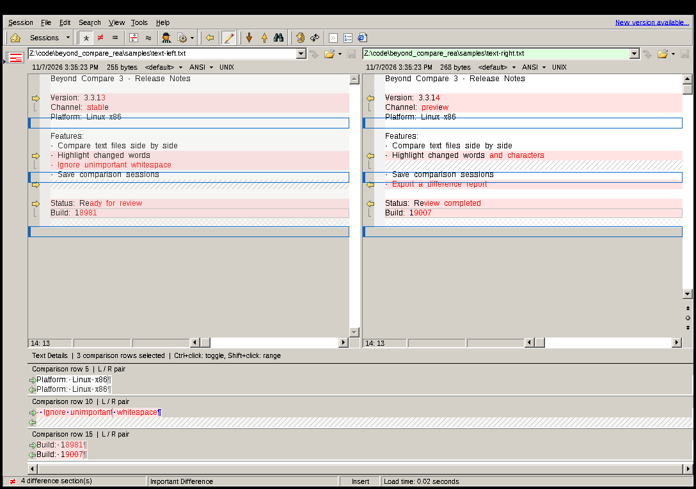
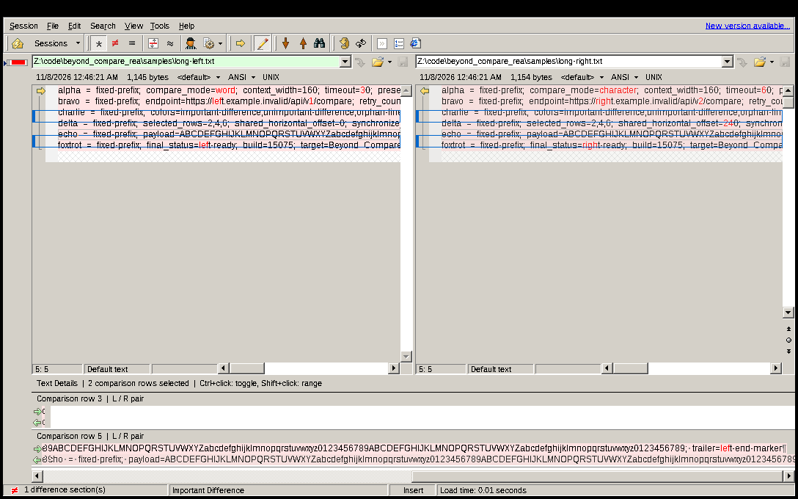
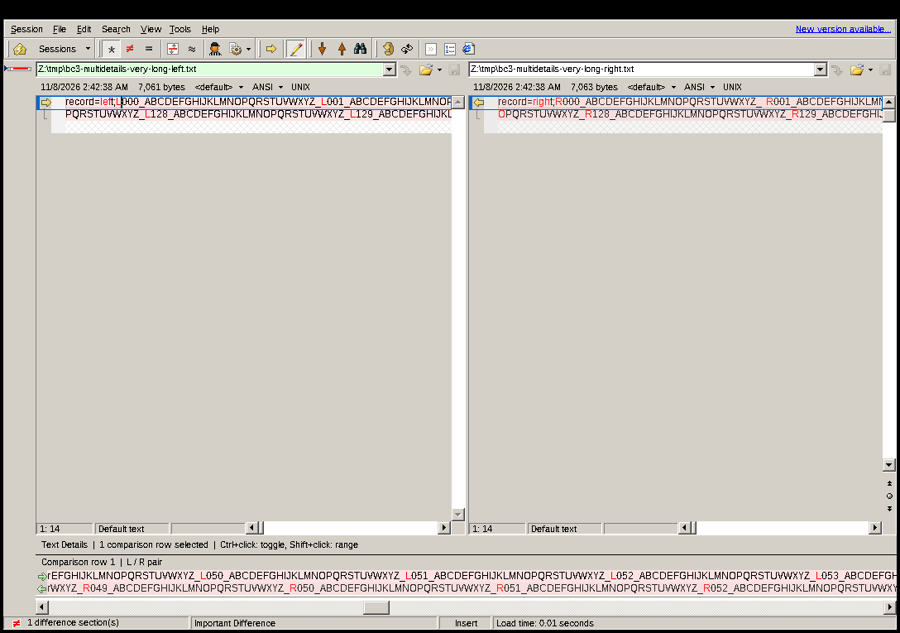

# BC3 MultiDetails

为 Windows 版 Beyond Compare 3.3.5（build 15075）增加可自定义多行的
Text Details 面板。

当前 GitHub 正式版：
[BC3MultiDetails-Setup-0.2.2.exe](https://github.com/CinderellaQAQ/beyond_compare_rea/releases/latest/download/BC3MultiDetails-Setup-0.2.2.exe)。

## 效果



选择不连续行后，每个比较项在底部左右两侧的 BC3 原生 Text Details 编辑器中
各占一行；底部唯一的横向滚动条会让全部原生行同步移动。点击底部任意一行可
放置原生文本光标，并让上方正文区跳到对应行列。



## 使用方式

在 Text Compare 上方正文区中选择比较行：

- 单击：只保留当前行。
- `Shift` + 单击：从锚点到当前行连续选择。
- `Ctrl` + 单击：追加或取消一条不连续行。
- `Ctrl` + `Shift` + 单击：把一个连续区间追加到已有选择。

底部按比较顺序在左右原生编辑器中显示所选行的字符差异。底部唯一的横向
滚动条控制全部行。选择较多时，底部面板最高扩展到 360 像素，并提供自己的
纵向滚动条。

在底部差异区中编辑选区：

- 单击底部任意文本行：放置输入光标，并让上方左右正文区跳到对应行列。
- 拖动：选择连续字符；`Shift` + 单击或 `Shift` + 方向键可扩展选区。
- 方向键、`Home`、`End`：移动光标；`Ctrl` + `A`：选中当前 L/R 整行。
- `Ctrl` + `C` 或 `Ctrl` + `Insert`：把当前选区复制到系统剪贴板。

## 目标版本下载

本扩展只支持 Windows 版 Beyond Compare 3.3.5（build 15075）。Scooter
Software 官网目前只公开提供 BC3 最终版 3.3.13，以下 3.3.5 安装包来自第三方
历史镜像，并非官方当前下载地址：

- [下载 BCompare-3.3.5.15075.exe](https://www3.btsoftware.com/pub/download/nt/BCompare-3.3.5.15075.exe)
- 安装包大小：`5,869,768` 字节
- 安装包 SHA-256：`19bf30d2dd518aae1dd3425d77e88c1700460fad9fe6b7e5f5821425798cbb6e`
- 安装后的 `BCompare.exe` SHA-256：`1d822b3faabb8f65fc30076d32a95757a2c369ccb64ae54572e9f562280ae845`

该镜像文件已与本项目逆向和测试所用安装包逐字节比对一致。由于来源为第三方
且软件版本较旧，请在下载后核对 SHA-256，并优先在隔离测试环境中使用。软件
许可仍由 Scooter Software 提供，用户应自行确保拥有合法使用资格。

## 安装

1. 关闭所有 `BCompare.exe` 进程。
2. 运行 `BC3MultiDetails-Setup-0.2.2.exe`。
3. 选择含有 `BCompare.exe` 的 Beyond Compare 3 安装目录，然后点击 **Install**。
4. 重新启动 Beyond Compare，打开 Text Compare 会话。

若已经安装本项目发布的 0.2.0 或 0.2.1，可直接运行 0.2.2 原地升级，无需先
卸载。升级器只会替换 SHA-256 精确匹配这两个正式版本的 DLL 与卸载器；未知
`version.dll` 仍会被安全保留并中止安装。

安装器请求管理员权限是因为默认安装位置通常位于 Program Files。它不包含
Beyond Compare 的任何程序文件，也不会修改 `BCompare.exe`。

安装器只接受以下精确目标：

- 文件大小：`9,571,304` 字节
- SHA-256：`1d822b3faabb8f65fc30076d32a95757a2c369ccb64ae54572e9f562280ae845`

若目标目录已有其他 `version.dll`，安装会安全中止，不覆盖该文件。

## 0.2.2 应用错误修复

- 修复第二条及后续所选行进入 BC3 两条原生样式回调时仍携带代理局部行号的
  问题。现在单元格样式和整行样式入口都会先把局部行号映射回原始比较行，
  避免 `TextContent` 访问不存在的行类别并触发 Delphi 原生断言。
- 上方正文当前行改为调用 BC3 原生设置器，不再直接改写内部当前行字段；原生
  设置器会同步视觉行、光标几何和重绘范围，灰色当前行边框不会再穿过文字。
- 修复多行详情已有若干行后，再从上方选择普通短行时，BC3 把原始行号直接写
  入较短的底部代理并触发 `item >= count` 原生断言的问题。
- 主编辑器的当前行变化在多行代理活动期间只同步上方区域；底部变更通过行号
  映射队列完成，避免原版单行同步与多行代理竞争。
- 详情数据源重绑延迟到 BC3 当前点击处理器释放模型锁之后，并保留原生数据源
  的锁定/解锁方法，避免后台比较与底部绘制并发读取中间状态。
- 比较会话原地重载时刷新原始数据源及模型所有者，不再保留上一会话的失效
  指针。
- 已复跑三条 10,000 字符差异、共享横向滚动到位置 8,379、底部点击回跳、
  `CF_UNICODETEXT 10000` 完整复制以及 150% DPI 边框显示。

## 0.2.1 原生多行实现

- 底部完全复用 BC3 的 `TUiEditorWindow` 原生文本编辑器、字符级差异渲染、
  光标、选区、复制和滚动逻辑，不使用位图缓存或自绘文本。
- 通过多行数据源代理把 `Ctrl` 选择的不连续比较项映射到原生 Text Details；
  点击底部任意行时，再映射回上方的原始比较位置。
- 多行模式下关闭原编辑器的单行约束并启用原生文本选择；退出多行模式时恢复
  BC3 原始选项。
- 将 BC3 原生行解析器的单行容量提升到其 `65,536` 上限，已验证一行
  10,000 字可完整显示、选中并复制。
- 两个各 10,000 行的压力样本中同时选择三条不连续的 10,000 字差异行，
  原生共享横向滚动与点击回跳均通过回归测试。

## 0.2.0 新功能

- 底部每条 L/R 差异文本都可点击放置光标、拖动选中并复制。
- 支持 `Shift` 扩选、方向键、`Home`/`End`、`Ctrl+A` 与 `Ctrl+C`。
- 底部光标或选区移动时，上方左右正文区自动跳到对应比较行和字符列。
- 底部切换比较组时同步切换 BC3 原生 Text Details 数据源，避免复制到最后
  一次点击的其他行。
- 通过两个各 10,000 行的压力样本验证三组差异同时显示、共享横向滚动、
  跨组定位与复制；偏移 2,046 像素处复制第一组得到 `klmnop-R00002-`。

## 0.1.1 修复

- 修复长差异行横向滚动一段距离后出现重复、错位或空白内容的问题。
- 缓存时显式同步左右原生 Text Details 编辑器，并按实际渲染位移测量列宽。
- 分段拼接只复制当前位图真实可用的像素，避免越界读取。
- 支持从本项目正式发布的 0.1.0 安全原地升级。

下图为 7,000 余字符差异行滚动 12 个底部视口后的结果；左右内容仍连续且
保持同一横向位置。



安装包尚未进行商业代码签名；Windows 可能显示 SmartScreen 提示。请先核对
本文末尾的 SHA-256，再决定是否运行。

## 卸载

在 Windows“应用和功能/程序和功能”中卸载 **BC3 MultiDetails**。卸载器只在
`version.dll` 与本扩展的内嵌副本逐字节一致时才删除它，并保留原始
`BCompare.exe`。卸载器自身可能在下次重启时完成清理。

## 实现与安全边界

扩展使用应用目录中的 `version.dll` 代理转发 BC3 所需的六个 Windows 版本
API，并仅在目标文件大小及关键机器码均匹配时启用内联挂钩。多行面板直接
复用 BC3 原生 Text Details 编辑器，并通过代理数据源把多个选中比较项呈现为
多条原生文本行；扩展不缓存或拼接差异位图。

运行日志位于 `%TEMP%\BC3MultiDetails.log`。若验证失败，扩展保持停用并在日志
中记录原因。

仓库及安装包不分发 Scooter Software 的专有二进制文件。`artifacts/`、
`extracted/` 与 `runtime/` 仅是本地研究/测试输入，不属于发布物。

## 构建

需要 GNU Make 和 32 位 MinGW-w64 工具链（默认命令前缀
`i686-w64-mingw32`）。若仓库工作区存在 `runtime/mingw/root`，Makefile 会自动
使用该本地工具链：

```text
make all
```

也可以显式指定工具链，例如：

```text
make CC=/path/to/i686-w64-mingw32-gcc \
  WINDRES=/path/to/i686-w64-mingw32-windres all
```

输出：

- `dist/version.dll`
- `dist/BC3MultiDetails-Setup-0.2.2.exe`

本次最终构建 SHA-256 见 `docs/TEST_REPORT.md`。
